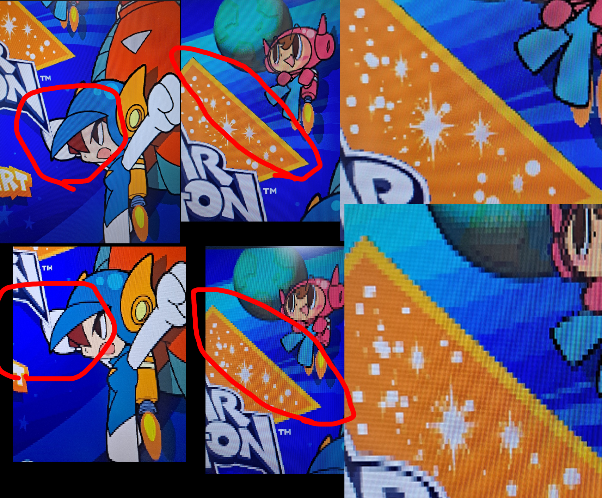

# Review of the Namco_S10 core (release 20261022) on real MiSTer hardware

Date: 2026-10-23
Reviewed: `Namco_System_10_MiSTer` at commit 7252337 (rbf `Releases/Namco_S10_20261022.rbf`)
From: the author of the other System 10 core (guljam, `namco-system-10-mister-core-beta`, MiSTer core name `SYSTEM10`).

This document is written for the Namco_S10 developer and any AI assistant they use. Each section has the
symptom as seen on hardware, the root cause found in the source, the fix we use in our core (with code), and how to
check it. File and line references are to the Namco_S10 repository unless marked "our core".

Thank you for publishing the core and for crediting our development notes. The goal here is the same as yours:
correct System 10 games on MiSTer.

## Summary

| # | Problem | Where | Root cause | Fix |
| --- | --- | --- | --- | --- |
| 1 | Mr. Driller 2 / G: slight stutter in the later 13-column stages | `Namco_S10.sv:933-938` | Data cache at half rate (`TURBO_CACHE50 = 1`): the CPU is still too slow for these stages | Full-rate cache plus a patch for the PSY-Q `VSync()` timeout (section 1) |
| 2 | HDMI: 480i screens look low-resolution, rough and shifted by about half a pixel | `Namco_S10.sv:2327` | `assign VGA_F1 = 1'b0;`: the scaler never sees the interlace field, so it cannot weave the fields | Drive `VGA_F1` with the field bit (section 2) |
| 3 | Mr. Driller 2 / G: input rate (autofire sync) | `rtl/s10_io.sv:45-46` | IRQ10 at MAME's 100 Hz placeholder; the game stores input on every other IRQ10, so it samples at 50 Hz against 60 fps | IRQ10 at 2x VBlank (section 3) |

Section 4 lists what your core does better than ours (faster boot, shorter HDMI blackout). Section 5 has smaller notes.

---

## 1. CPU speed: half-rate data cache is not enough for Mr. Driller 2 / G

### Symptom

Mr. Driller 2 and Mr. Driller G, in the later stages with the wide (13-column) playfield: short, slight
stutters during play. We had exactly the same symptom in our early builds with the same turbo setting
(Turbo High + half-rate cache). It went away with the full-rate cache.

### What the clocks really are

* The System 10 CPU (CXD8606) runs at 101.4912 MHz / 2 = **50.7456 MHz**, 1.5x a PlayStation (MAME `namcos10.cpp`).
  System 12 (CXD8661R, the Tenkomori Shooting core) runs at **50 MHz**. System 10 is about 0.75 MHz (1.5 %) faster.
* Both cores, ours and yours, clock the CPU at **33.8688 MHz** (`clk_1x`). Your README says this correctly.
  The turbo flags (`TURBO_MEM`, `TURBO_COMP`, `TURBO_CACHE`, `TURBO_CACHE50`) do not change the clock. They remove
  memory wait states and compute stalls and add a data cache. The speed-up they give depends on the code being run:
  cache hit rate, memory accesses, GTE use.
* So "the System 12 turbo/cache profile" is not "50 MHz". The comment at `Namco_S10.sv:930-934` and the commit message
  of 742fa82 ("CPU turbo for 50 MHz") treat it as equal to the board speed. It is not calibrated against the
  System 10 games. The Tenkomori core chose the half-rate cache for a different reason (the `VSync()` timeout below),
  not because half rate equals 50 MHz.

### Why not just turn on the full-rate cache

If you set `TURBO_CACHE50 <= 1'b0`, the stutter goes away, but a second bug appears: a one-frame picture glitch at
some scene cuts (Mr. Driller G attract mode, about 45-47 s and 1:06 after the BIOS screen, in 480i). The cause:

* The games use the PSY-Q libetc `VSync()` function. Its inner wait loop `v_wait` has an iteration timeout:
  `sll a1,a1,15` (32768 loops, instruction word **0x00052BC0**, at 0x8027CD70 in mrdrilrg).
* In MAME the loop uses about 28,800-29,500 of the 32,768 iterations per field. That is only about 10 % margin.
* With Turbo High and the full-rate cache, the loop runs about 13 % faster than in MAME: 32,768 iterations take
  16.65 ms, less than one field. The timeout fires just before VBlank on almost every field (harmless), and after a
  loading frame it fires in the middle of the field. The game then flips the display and starts the draw list in
  the middle of the field, and the interlace fields mix (the glitch).
* With the half-rate cache the loop is slower, so it rarely times out. That is why the half-rate setting hides the
  glitch, at the cost of the stutter.

We found this with a GPU command trace on hardware and the MAME debugger. Full details: our core,
`docs/fixes-2026-10-19.md`.

### Fix (our core, `rtl/cpu.vhd:654-661`)

Keep the full-rate cache and double the `VSync()` timeout. While the cache turbo is on, the CPU replaces the
instruction word `sll a1,a1,15` (0x00052BC0) by `sll a1,a1,16` (0x00052C00), both on the i-cache fill path and on
the uncached fetch path:

```vhdl
   -- NS10: PSY-Q VSync waits for the next vblank with an iteration timeout (v_wait, "sll a1,a1,15" =
   -- 32768 loops). With the cache turbo the loop runs faster than on the real CPU and the timeout
   -- expires before vblank (frame flip mid-field, mrdrilrg scene cut glitch). Double it while the
   -- cache turbo is on; the word only occurs in v_wait in the NS10 games checked (MAME RAM dumps).
   fetch_dataRead     <= x"00052C00" when (TURBO_CACHE = '1' and mem_dataRead = x"00052BC0") else mem_dataRead;
   cache_data_patched <= x"00052C00" when (TURBO_CACHE = '1' and cache_data   = x"00052BC0") else cache_data;
```

* `cache_data_patched` replaces `cache_data` as `data_a` of the i-cache RAM (the fill from SDRAM, `clock_a => clk3x`).
* `fetch_dataRead` replaces `mem_dataRead` in the fetch process (sensitivity list and `opcodeNext <= unsigned(fetch_dataRead);`).
* Then set `TURBO_CACHE50 <= 1'b0` in `Namco_S10.sv`.

Result on hardware (our core, commit 21a5eea): Mr. Driller G trace over 68 s, pre-VBlank timeouts 160 -> 0,
mid-field flips 1 -> 0; no stage-13 stutter; both attract glitch scenes gone.

### Caution for your 22 games

We checked that the word 0x00052BC0 occurs only in `v_wait` for the games we support: Mr. Driller 2 (all sets),
Mr. Driller G, Gamshara and Star Trigon (MAME RAM dumps). You support more games. Before using the patch, dump each
game's main RAM in MAME during play and search for the word 0x00052BC0. If it appears anywhere other than `v_wait`,
the patch would change that code too; then the patch needs an address check (for example, only when the following
word is the `v_wait` loop body).

A debug OSD switch for the cache (Full / Half) helps for A/B tests on hardware. Ours is `O[83] Turbo Cache (High)`
in the debug build only.

---

## 2. HDMI: 480i screens lose half their vertical resolution

### Symptom

On an HDMI flat panel, the 480i screens (Star Trigon title, Mr. Driller G, Gamshara, Kono e Tako) look
low-resolution and rough, and the picture feels shifted by about half a pixel. On a 15 kHz CRT the same screens look
correct. 240p screens are fine on both.

Photos of the Star Trigon title screen on the same HDMI monitor (our core, then Namco_S10):

Photo: `user_image/hdmi_bug.png` (red marks = areas to compare)

* top row and top-right zoom: our core - fine pixels, sharp outlines
* bottom row and bottom-right zoom: Namco_S10 - large blocky pixels, stair-stepped diagonals



### Root cause

`Namco_S10.sv:2327`:

```verilog
assign VGA_F1 = 1'b0;
```

The MiSTer scaler (`sys/ascal.vhd`, input `i_fl` from `VGA_F1`) needs the interlace field bit to recognize interlaced
input and to weave the two 240-line fields into one 480-line frame. With `VGA_F1` tied low:

* each 240-line field is taken as a whole progressive frame, so the vertical resolution is halved;
* the odd and even fields are written into the same lines one after the other, so the picture moves by half a line
  each field (this is the "half-pixel shift" feeling);
* 240 lines are scaled to the output height by a non-integer factor (4.5x at 1080p), so the line heights are uneven
  and the blocks look rough.

The field bit is already there: `video_aspect.interlace` is registered at `Namco_S10.sv:2214` from `psx_interlace`
(PSX_MiSTer `videoout_out.interlace = GPUSTAT_VerRes and GPUSTAT_InterlaceField`, which toggles every field in 480i
and is 0 in 240p). It is never sent to the scaler.

The analog output is not affected because it is the native 15 kHz signal, which the CRT interlaces by itself.

`MISTER_SMALL_VBUF` is not the cause: 2 MB per scaler buffer holds 640x480 even at 4 bytes per pixel (1.2 MB).

### Fix

Our core (`NAMCOS10.sv:1137`) does this:

```verilog
assign VGA_F1 = video_aspect.interlace;
```

Your core sends the picture through `video_mixer` (Scandoubler Fx). The scandoubled signal is progressive, so the
field bit should only be passed when the scandoubler is off:

```verilog
assign VGA_F1 = sd_enable ? 1'b0 : video_aspect.interlace;
```

`HDMI_BOB_DEINT = status[41]` is already wired (`Namco_S10.sv:181`). With the field bit passed, the scaler weaves by
default, or uses bob when it is set. If you want, an OSD item `O[41],Deinterlacing,Weave,Bob;` exposes it (ours is
under Video & Audio).

### Side effect: HDMI blackout with `vsync_adjust=2`

With `vsync_adjust=2` the HDMI output follows the core's video timing, so each input mode change re-syncs the
monitor (black screen). On hardware your core's blackout at the game's resolution change is shorter than ours.
The likely reason, not yet measured: with `VGA_F1` tied low the scaler sees 480i and 240p as the same kind of
progressive input of about 240 lines, so a 240p <-> 480i switch is not a mode change for it. Once `VGA_F1` is
passed, these switches become real mode changes (interlace on/off, 240 <-> 480 lines) and the blackout may get
longer. We are looking at this on our side (section 4.3). The picture quality fix is still the right default.

### Check

* HDMI, Scandoubler Fx = None, Star Trigon title or Mr. Driller G in-game: the picture should be as sharp as the
  first two photos.
* The MiSTer OSD info (or `vsync_adjust` log) should report 480i input, not 240p.
* 240p games: no change.

---

## 3. Mr. Driller 2 / G input rate: IRQ10 at 2x VBlank

### Background

On real hardware a "sync" autofire on Mr. Driller (one press per frame pair, 30 per second) drills cleanly. With
MAME's 100 Hz IRQ10 it does not stay in sync. We traced why.

* The Driller games read IN1 (0x1FBA0004) in the IRQ10 handler, but the input library stores the value only on
  every other call (game ROM code, not MAME or the core: mrdrilr2j 0x8016CEB4, mrdrilrg 0x80296C08). The game copies
  the latest stored value once per frame, right after VBlank.
* At 100 Hz IRQ10 the game sees 50 input samples per second against 60 frames: some frames repeat a sample and the
  autofire beats against the frame rate (MAME measurement: toggle on every 2nd IN1 read = 25.01/s, with about 160
  repeated frames per test).
* MAME's 100 Hz is a placeholder. It came with the 2023 driver refactor (MAME commit ec6b3d2b5542) with the comment
  "TODO: Trace main PCB to see where JAMMA I/O goes and/or how int10 can be triggered". There is no hardware source for it.
* The library structure fits 120 Hz: the "every other call" phase is the PSX libpad per-VBlank emulation, and the only
  other IRQ10 use is a comms timeout of 120 ticks (1 s at 120 Hz). The games do not use IRQ10 for timekeeping, so the
  rate does not change game speed.

### What we do (our core, `rtl/ns10/ns10_io.sv`)

IRQ10 fires twice per frame, at 1/4 and 3/4 of the last measured frame length after each GPU VBlank (away from the
game's input copy just after VBlank). The game then stores exactly one sample per frame.

```verilog
// 2x VBlank: IRQ10 at 1/4 and 3/4 of the last frame length after each VBlank
localparam integer FRAME_NOM = 565050;               // 33868800 / 59.94
reg        vbl_1;
reg [19:0] fcnt, fper;
wire       vbl_rise = vblank & ~vbl_1;
wire       vbl_tick = (fcnt == {2'b00, fper[19:2]}) || (fcnt == {2'b00, fper[19:2]} + {1'b0, fper[19:1]});
...
		vbl_1 <= vblank;
		if (vbl_rise) begin
			fcnt <= 0;
			fper <= fcnt;
		end else if (~&fcnt)
			fcnt <= fcnt + 1'd1;

		if (irq10_vbl ? (vbl_tick && !vbl_rise) : (tcnt == TIMER_PERIOD - 1)) begin
			intr[3]  <= 1;
			irq10    <= 1;
		end
```

`vblank` is the PSX `irq_VBLANK` line, exported from `psx_top` (`vblank_irq <= irq_VBLANK;`). `fper` resets to
`FRAME_NOM`. The 100 Hz timer stays as a debug option (`O[87] IRQ10 (Input),2xVBlank,100Hz`); release builds use
2x VBlank.

Results:

* Simulation: an autofire synced to the input reads gives 29.97/s with 0 repeated frames; 0 of 40 short (17 ms)
  taps lost (100 Hz: 7 of 40 lost).
* MAME with the same 2x VBlank IRQ10 (patched copy): Driller 2 and G 29.91/s with 1 repeat, against 25/s with about
  160 repeats at 100 Hz. Menus, play and test mode behave the same in both modes; Gamshara and Star Trigon are
  identical in both modes.
* Hardware: clearly smoother, and it matches videos of the real cabinets.

Full write-up: our core, `docs/rapid-fire-irq-eng.md`.

### For your core

* `rtl/s10_io.sv` also raises IRQ10 for the CD-ROM interrupt (Taiko, line 150). Keep that path; change only the
  timer source (status bit 3).
* Check the other games that use IRQ10 for input, at least once in each mode. We only checked our four games.

---

## 4. Where your core is better

### 4.1 Faster boot (color-bar screen)

On hardware, your core passes the boot screen with the colored bars several seconds sooner than ours.

Cause, from the source: the System 10 BIOS module runs from kseg0 (0x9FC2xxxx), which is cacheable. In your
`rtl/memorymux.vhd:768-795` a cacheable fetch from the boot program area does an i-cache line fill
(`ram_cache <= '1'`, burst, tags valid). Our core fixed an earlier i-cache bug at that address by not marking the
tag valid, so every BIOS instruction is an uncached 25-26 cycle read. Your way is the correct one. We will move to
a burst line fill for kseg0 BIOS fetches.

### 4.2 Loading display

Your MRAs stream the BIOS part as ioctl index 0 before the `address=` DDR3 parts. The MiSTer menu then shows a normal
ROM loading bar first and the assembly bar after it. Ours loads everything through one `address=` ROM, so only the
assembly bar moves. This is only cosmetic. We are not changing it.

### 4.3 Shorter HDMI blackout with `vsync_adjust=2`

At the game's resolution change your core's HDMI picture comes back sooner than ours. As explained in section 2,
part of this is probably the `VGA_F1` tie-off: your scaler input never changes between interlaced and progressive.
We will count and time the mode changes in both cores before deciding anything. Removing the interlace flag is
not an option for us, because it halves the 480i resolution.

---

## 5. Smaller notes

* **ascal timing macros.** Your qsf sets `MISTER_SMALL_VBUF`, `MISTER_DISABLE_ADAPTIVE` and `MISTER_DISABLE_YC`.
  They shrink the scaler logic and help timing closure on the HDMI clock. They do not cause the 480i problem.
* **`rtl/cpu.vhd`** still carries a lot of System 11 bring-up diagnostics: first-fault latches, a 64-entry trace ring,
  a 256-entry MAME table, two extra MLAB register files and a 32x32 flip-flop shadow register file that now feeds
  `value1` / `value2`. The flip-flop register file adds a large read multiplexer in front of the ALU on `clk_1x`. If
  System 10 does not need it (the original fault was a System 11 decompressor issue), removing it frees logic and
  timing margin.
* **`dcache_write_clear`** in your `cpu.vhd` only fires for RAM addresses (`< 0x800000`). That is a good change; ours
  also clears on I/O writes (harmless, slightly slower).
* **GP1(01) hold (`memorymux` `gp1_hold`) and field lock.** For the Gamshara / Star Trigon 480i problems you hold the
  CPU on GP1(01) until the GPU is idle; we keep the current field until the GPU is idle (`fieldLock` in `gpu.vhd`)
  and fetch texture rows in bursts. Both work. Note that the GP1(01) hold stalls the CPU for up to about 15 ms, which
  can make frames late on the 1.5x-slower GPU.
* **Savestates.** We have working savestates for the four games we support (4 slots, 8 MB in DDR3 at 0x3C000000:
  RAM 4 MB, VRAM 2 MB, the board state and NVRAM). If you want to restore them, our board state code can be a starting point.

## Contact

Questions about any of these points: open an issue on our repository (`guljam/namco-system-10-mister-core-beta`).
The "fixes" documents referenced above are in our core's `docs/` folder.
